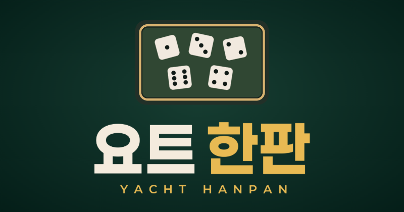
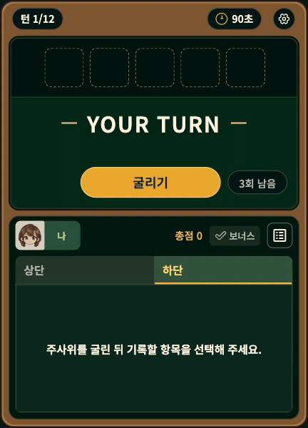
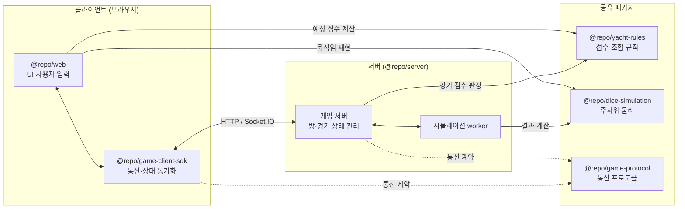

# 요트 한판 (Yacht Hanpan)



**설치 없이 브라우저에서 바로 즐기는 1:1 요트 주사위(Yacht Dice)**

물리 기반 주사위로 더욱 생동감 있게 즐겨보세요.

**게임 링크**: [https://yacht-hanpan.pages.dev](https://yacht-hanpan.pages.dev)

## 플레이 방법

1. 같이 플레이할 친구에게 방 코드를 공유하여 게임을 시작합니다.
2. 본인 턴에 주사위 다섯 개를 최대 3번 굴릴 수 있습니다. 원하는 주사위는 보관하고 나머지는 다시 굴립니다.
3. 원하는 점수 카테고리에 결과를 기록합니다. 두 플레이어가 12턴을 플레이한 후 최종 점수로 승패를 가립니다.

## 미리보기



## 프로젝트 구조



서버가 게임의 상태와 판정을 관리하고, 클라이언트는 서버가 확정한 결과를 렌더링합니다. 규칙 모듈을 분리하여 클라이언트와 서버가 동일한 점수 계산 로직을 공유합니다.

## 기술 스택

| 영역          | 기술                                  | 역할                                     |
| ------------- | ------------------------------------- | ---------------------------------------- |
| 웹 클라이언트 | React · TanStack Router · Vite        | 게임 UI 및 라우팅                        |
| 3D 주사위     | Three.js · React Three Fiber · Rapier | 주사위·컵의 3D 렌더링 및 물리 시뮬레이션 |
| 서버          | Bun · Socket.IO                       | 방·경기 판정, 명령 처리, 접속 관리       |
| 모니터링·수집 | Sentry · Google Analytics             | 오류 추적 및 이용 통계                   |
| 테스트        | Vitest · Bun Test · Playwright        | 단위·통합·E2E 테스트                     |
| 호스팅        | Cloudflare Pages · Render             | 게임 데모 배포                           |

## 주요 설계

### 시드 기반 물리 재현

양쪽 브라우저에서 동일한 주사위 움직임을 보여주기 위해, 세부 프레임 데이터를 매번 전송하는 대신 시드 기반 재현 방식을 채택했습니다. 서버에서 시드를 확정하면 클라이언트는 동일한 물리 엔진과 시드로 움직임을 재현합니다.

### 중복 요청 방지와 세션 복구

네트워크 지연으로 같은 요청이 중복 전송되거나 연결이 끊겨도 경기 상태가 어긋나지 않도록, 중복 요청 방지 및 세션 복구 로직을 구현했습니다. 동일한 요청은 한 번만 적용되며, 새로고침이나 재접속 시 방과 권한이 유효한 동안 서버의 최신 상태로 안전하게 복귀합니다.

### 반응형 게임 화면

다양한 기기에서 일관된 게임 경험을 제공하기 위해 게임판 전체를 균일하게 확대·축소합니다. 브라우저 특성상 화면 방향을 강제로 고정하기 어렵기 때문에, 플레이 공간이 부족해지는 상황(예: 가로 모드)에 대비해 가용 공간을 기준으로 안내를 표시하고 입력을 차단합니다. 공간이 확보되면 최신 상태를 반영해 조작을 재개합니다.

## 로컬 실행 방법

요구사항: Node.js 22.12+, Bun 1.4.2+

저장소 루트에서 의존성을 설치한 후, 아래 명령어로 서버와 웹을 각각 실행할 수 있습니다.

```bash
# 의존성 설치
bun install --frozen-lockfile

# 게임 서버 실행
bun --filter @repo/server dev

# 웹 클라이언트 실행
bun --filter @repo/web dev
```

- 웹 주소: http://localhost:3001
- 서버 포트: 기본값 3002 사용
- 기본 설정을 변경하려면 각 앱의 `.env.template` 파일을 `.env.local`로 복사하여 수정하세요.

## 운영 제약

- 현재 게임 데이터는 서버 인메모리에만 저장되므로, 서버 재시작이나 배포 시 진행 중인 게임 데이터가 유실될 수 있습니다.
